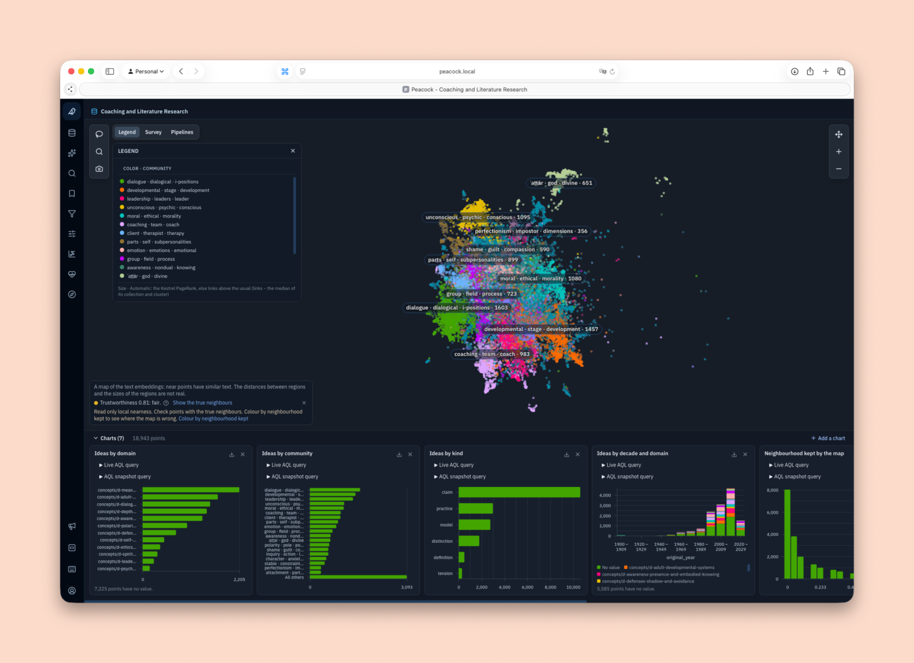

# PeacockUI

**The research console for [AquilaDB](https://github.com/FranciscoSerranoBaptista/AquilaDB) and [KestrelAnalytics](https://github.com/FranciscoSerranoBaptista/KestrelAnalytics).** PeacockUI turns a graph database into a research instrument. A researcher starts from a question, reads a ranked answer, and keeps the question with its finding.

Built for [The Land Institute](https://landinstitute.vercel.app), research on how adults develop at work.

  

<em>The ideas map: ideas from the literature placed by meaning, coloured by community, with charts over the loaded points.</em>

This repository is the public face of the project: the description and the public issues. The source code is private.

## The problem it solves

A force layout of a dense graph gives a hairball. The layout optimises the length of the edges, not the question of the researcher. A picture of several thousand points looks interesting and says little.

Investigative tools and science-mapping tools agree on a different loop. PeacockUI is built on it:

1. **Start from a question:** a seed, a selection or a saved query, not a whole collection.
2. **Expand within a limit:** one hop and one type at a time, with the count shown first.
3. **Read a ranked list or a histogram,** not only the layout.
4. **Select a subset and group the leaves.**
5. **Keep the question:** save the subset, the note and the finding as a named view.

## The questions it answers

Each view starts from a question that a researcher asks, not from a collection.

| A researcher asks | PeacockUI answers with |
|---|---|
| What are the main research areas? | The ideas map: points placed by meaning, and communities that hold across runs. |
| What rises and what fades? | The lineage of each community across runs. |
| Where is the data weak? | The health panel: a verdict for each data layer, with ranked blockers. |

The next questions are in [Where it is going](#where-it-is-going).

## What it does today

- **Three workspaces:** the graph canvas, an AQL editor, and an assistant that turns a plain-English question into AQL.
- **Views that you can reproduce.** A view is a scope (what loads), a profile (how it looks) and filters (what shows). Saved views live on the server for each user, with a personal default and JSON export.
- **Kestrel on the canvas.** Colour by community, size by centrality, keep only the stable members, and run an analysis from the console.
- **An embedding map.** Points placed by meaning from a Kestrel projection, with the simulation off.
- **Community history.** The lineage of a point across runs, and a Sankey of community lineage.
- **Charts that filter.** Six chart types over the loaded points, with click-to-filter. On data about people, a cohort floor of five applies and scatter plots are refused.
- **Suggested views** from the stored analysis runs.
- **A health panel.** A verdict for each data layer with ranked blockers. "Show" filters the canvas to the failing records.
- **Safe by default.** The access key never reaches browser code. Sessions use an HttpOnly cookie, and writes are checked for origin.

## Where it is going

| A researcher asks | PeacockUI will answer with |
|---|---|
| Which ideas shape the field? | A ranked list by PageRank against citation count, the core of the graph, and a halo on each point that is unusual for its class. |
| What are the main research areas? | A name on each region of the ideas map. |
| What rises and what fades? | Communities in each time window, and a difference view between two windows. |
| Which ideas could combine, but do not yet? | Structural gaps: pairs of communities that are close in meaning but not linked, with the candidate bridges between them. |
| Where does an idea come from? | The path back to its sources with the weakest link marked. |
| How far can we trust a claim? | The trust plane: surprise against grounding, in four labelled quadrants. |
| How does a group change over time? | Tables, time windows and trajectories on data about people, under the cohort floor. |

The engine already computes most of the answers: PageRank, Leiden with stability, community lineage, the embedding map, k-core, bridges, link prediction, `SURPRISE` and `JUSTIFY`. The console needs three things to use them.

- **An entry point.** Start from a search, and expand one hop and one type at a time. The neighbour count shows before the canvas grows.
- **A vocabulary.** Named communities, a ranked-list chart, halos on residuals, edges weighted by confidence, and leaf points grouped into a count.
- **A memory.** A saved view keeps its selection and a note with the question and the finding. A saved query runs on the current selection.

## Built with

[cosmos.gl](https://github.com/cosmograph-org/cosmos) for the graph, [Unovis](https://unovis.dev) for charts, React and Vite.

## The stack

| Part | Role |
|---|---|
| **[AquilaDB](https://github.com/FranciscoSerranoBaptista/AquilaDB)** | The engine: the records, their relations over time, and the privacy rules. |
| **[KestrelAnalytics](https://github.com/FranciscoSerranoBaptista/KestrelAnalytics)** | Graph and population analytics: communities with stability, centrality, statistics, pre-registered studies. |
| **PeacockUI** | The research console: start from a question, read ranked answers, keep the question with its finding. |

## Status

Ships with AquilaDB 1.3 (November 2026).

## Issues

Use the issues here for questions, ideas and collaboration requests. The working backlog is private.

**Do not post personal data in an issue.** An issue is public. To report a vulnerability, see [SECURITY.md](SECURITY.md).

© 2026 Francisco Serrano Baptista. All rights reserved.
